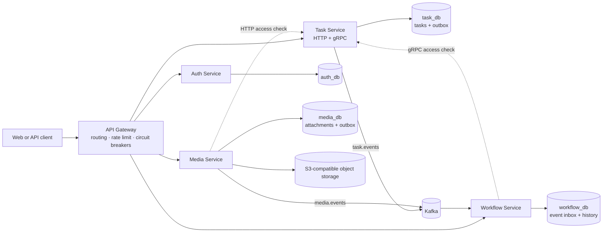
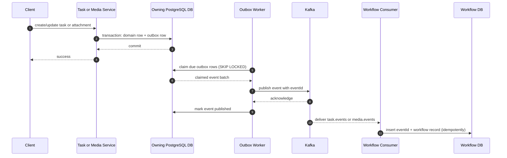

# Node.js Microservices

A TypeScript microservices reference project for task management, media attachments, and workflow history. It demonstrates explicit service and data ownership, synchronous HTTP and gRPC calls, asynchronous Kafka events, transactional outboxes, downstream authorization, and failure handling around service dependencies.

## Architecture



The repository is organized as npm workspaces: `apps/*` contains independently runnable services and `packages/shared` contains infrastructure and cross-cutting primitives. Each service owns its data and schema. Cross-service identifiers are references; service databases do not use cross-service foreign keys.

| Component | Responsibility | Data ownership | Interfaces |
| --- | --- | --- | --- |
| API Gateway | External HTTP entry point, routing, rate limiting, upstream circuit breakers | None | HTTP |
| Auth Service | Registration, login, signed access tokens, current-user endpoint | Users and credentials (`auth_db`) | HTTP |
| Task Service | Task lifecycle and task access decisions | Tasks (`task_db`) | HTTP and protobuf gRPC |
| Media Service | Attachment upload and listing; delegates task access decisions to Task | Attachment metadata (`media_db`) and object storage objects | HTTP, then HTTP to Task |
| Workflow Service | Consumes domain events and serves task workflow history | Workflow history and consumed event IDs (`workflow_db`) | HTTP, Kafka, and gRPC to Task |
| Kafka | Asynchronous task and media event transport | Event log | Kafka protocol |

## Request and event flows

### Synchronous authorization

The gateway authenticates the internal hop and routes requests; it does not verify end-user tokens or apply role rules. Each service verifies the signed bearer token and derives identity from its claims. The service that owns the protected resource decides whether that identity can access it.

```mermaid
sequenceDiagram
    autonumber
    actor User
    participant Gateway as API Gateway
    participant Media as Media Service
    participant Task as Task Service
    participant DB as Task Database
    User->>Gateway: GET /tasks/:id/attachments + bearer token
    Gateway->>Gateway: strip client identity headers; add gateway credential
    Gateway->>Media: forward request
    Media->>Media: verify signed token and derive user identity
    Media->>Task: HTTP access check (bounded retry + circuit breaker)
    Task->>Task: verify gateway credential
    Task->>DB: check task ownership/access
    DB-->>Task: access decision
    Task-->>Media: { exists, allowed }
    Media-->>Gateway: attachment response
    Gateway-->>User: response
```

Media uses the Task Service internal HTTP access endpoint. Workflow uses the protobuf `TaskAccessService.CheckTaskAccess` gRPC method. Both adapters call the same Task Service `checkTaskAccess()` business logic. The generated TypeScript client and server definitions are kept under `packages/shared/src/grpc/generated`; the source contract is `proto/task_access.proto`.

### Event-driven workflow history

Task and Media write the business change and its outbox record in one database transaction. Their outbox workers publish events after commit. Workflow consumes both topics and stores each event ID with its workflow record so redelivery does not duplicate the history entry.



Kafka delivery is **at least once**. A crash after Kafka accepts a message but before the outbox row is marked published can produce a duplicate. Workflow's event-ID uniqueness makes consumption idempotent. Outbox processing claims rows with `FOR UPDATE SKIP LOCKED` and releases the database transaction before network I/O.

## Resilience model

Synchronous calls are bounded by timeouts and retries appropriate to their semantics. Circuit breakers stop repeatedly calling a failing dependency and allow a limited recovery probe after a cool-down.

```mermaid
stateDiagram-v2
    [*] --> Closed
    Closed --> Open: failure threshold reached
    Open --> HalfOpen: cool-down elapsed
    HalfOpen --> Closed: probe succeeds
    HalfOpen --> Open: probe fails
    HalfOpen --> HalfOpen: probe in flight; other calls receive 503
```



- The gateway keeps one breaker per upstream service. Upstream `5xx` responses and proxy errors count as failures; `4xx` responses are valid upstream responses. While open, the gateway returns `503 Service Unavailable` and a `Retry-After` header.
- Media→Task HTTP and Workflow→Task gRPC have independent breakers in their respective service processes. They apply the same threshold and cool-down defaults as the gateway.
- Defaults are five consecutive failures to open, a 10 second open period, and one half-open probe. Tune them with `CIRCUIT_BREAKER_FAILURE_THRESHOLD` and `CIRCUIT_BREAKER_OPEN_MS`.
- Breaker state is **process-local**. It protects each running instance independently; it is not a cluster-wide health signal or shared coordination mechanism.
- Media retries the idempotent access-check `GET` once for network errors, timeouts, and selected gateway errors (`502`, `503`, `504`). Workflow retries gRPC `UNAVAILABLE` and `DEADLINE_EXCEEDED` within a three-second total deadline. Non-idempotent HTTP requests are not automatically retried.
- PostgreSQL startup readiness uses bounded retries. Pool connections, statements, and queries have time limits. Kafka clients use bounded connection/request timeouts and retry policies.
- On `SIGTERM`/`SIGINT`, services stop accepting HTTP requests, drain active connections, stop consumers or outbox workers, and close gRPC and database resources in order, subject to `SHUTDOWN_TIMEOUT_MS`.

## Security boundaries

- The gateway strips caller-supplied identity headers before setting the internal gateway credential. It performs routing and coarse edge rate limiting, not user authorization.
- Authenticated services validate the bearer JWT and derive user ID and role from signed claims; forwarded client headers are not the source of truth.
- Task owns access checks for tasks. Media and Workflow ask Task for decisions rather than maintaining a second copy of Task authorization rules.
- Internal HTTP and gRPC calls carry `GATEWAY_SECRET`. The gRPC contract is a service-to-service API, not an end-user endpoint.
- HTTP request logs redact authorization, cookie, and gateway-secret headers. Configure real secrets outside source control; `.env.example` contains local placeholders only.

## Repository layout

```text
apps/
  api-gateway/       External HTTP routing and gateway circuit breakers
  auth-service/      Registration, login, JWT validation
  task-service/      Task API, access checks, gRPC server, task outbox
  media-service/     Attachment API, object storage, Task HTTP client, media outbox
  workflow-service/  Kafka consumer, history API, Task gRPC client
packages/
  shared/            Database, Kafka, auth, HTTP, lifecycle, gRPC and resilience primitives
proto/               Source protobuf contracts
sql/{auth,task,media,workflow}/  Service-owned ordered migrations
docker/              Local PostgreSQL/Kafka compose and database bootstrap
tests/               Unit and integration tests
```

## Local development

### Prerequisites

- Node.js and npm (the repository uses npm workspaces)
- Docker with the Compose plugin
- An S3-compatible endpoint for exercising media uploads; the Compose stack does not start object storage

### Start infrastructure and services

1. Install workspace dependencies with `npm install`.
2. Copy `.env.example` to `.env`. Replace `JWT_SECRET` and `GATEWAY_SECRET`; configure storage variables for uploads.
3. Start PostgreSQL and Kafka: `docker compose -f docker/docker-compose.yml up -d` (or `npm run kafka:up`). PostgreSQL creates the four service databases and logins on first initialization.
4. Apply all service migrations: `npm run db:migrate`.
5. Start each process in a separate terminal from the repository root:

   ```bash
   npm run dev:auth
   npm run dev:task
   npm run dev:media
   npm run dev:workflow
   npm run dev:gateway
   ```

The gateway listens on port `3000` by default. Service ports, connection addresses, timeouts, retry policies, and breaker thresholds are configurable in `.env`. Each service exposes `/health` for a basic process health check; dependency readiness is checked during startup.

### Useful commands

| Command | Purpose |
| --- | --- |
| `npm test` | Run unit and integration tests |
| `npm run db:migrate` | Apply migrations to all four service databases |
| `npm run db:migrate:task` | Apply Task Service migrations only |
| `npm run proto:generate` | Regenerate TypeScript from `proto/task_access.proto` |
| `npm run kafka:up` | Start local PostgreSQL and Kafka Compose services |
| `npm run kafka:logs` | Follow Kafka logs |
| `npm run kafka:down` | Stop local infrastructure |

### Example HTTP routes

| Method | Gateway route | Service | Purpose |
| --- | --- | --- | --- |
| `POST` | `/auth/register` | Auth | Register a user |
| `POST` | `/auth/login` | Auth | Authenticate and receive a signed token |
| `GET` | `/auth/me` | Auth | Return the authenticated user |
| `POST` | `/tasks` | Task | Create a task |
| `GET` | `/tasks` | Task | List tasks visible to the caller |
| `GET` | `/tasks/:id` | Task | Read a task |
| `DELETE` | `/tasks/:id` | Task | Delete a task (service-owned policy) |
| `POST` | `/tasks/:taskId/attachments` | Media | Upload an image attachment (`image`, max 10 MiB) |
| `GET` | `/tasks/:taskId/attachments` | Media | List attachments |
| `GET` | `/tasks/:taskId/workflows` | Workflow | Read workflow history after Task authorization |

Protected routes require `Authorization: Bearer <token>`. Registration and login are public routes behind the gateway. The task access endpoint and gRPC server are internal service interfaces.

## Configuration reference

See `.env.example` for the complete local template. Core settings:

| Variable | Default | Description |
| --- | --- | --- |
| `*_SERVICE_URL` | Local service URLs | Gateway and Media HTTP upstreams |
| `TASK_GRPC_URL` / `TASK_GRPC_BIND_ADDRESS` | `localhost:50051` / `0.0.0.0:50051` | Workflow client and Task gRPC server addresses |
| `*_DATABASE_URL` | Local Compose databases | One connection URL per owning service |
| `KAFKA_BROKERS` | `localhost:9092` | Kafka bootstrap broker list |
| `JWT_SECRET` / `JWT_EXPIRES_IN` | Placeholder / `7d` | JWT signing secret and expiry; replace the secret |
| `GATEWAY_SECRET` | Placeholder | Shared internal-hop credential; replace the secret |
| `HTTP_PROXY_TIMEOUT_MS` | `5000` | Gateway upstream timeout |
| `HTTP_CLIENT_TIMEOUT_MS` | `1500` | Per-attempt Media→Task HTTP timeout |
| `TASK_GRPC_TIMEOUT_MS` / `TASK_GRPC_RETRIES` | `3000` / `1` | Workflow→Task total deadline and retry count |
| `CIRCUIT_BREAKER_FAILURE_THRESHOLD` | `5` | Consecutive dependency failures before opening a circuit |
| `CIRCUIT_BREAKER_OPEN_MS` | `10000` | Cool-down before a half-open recovery probe |
| `OUTBOX_MAX_RETRIES` | `8` | Publish attempts before an outbox event is marked failed |
| `SHUTDOWN_TIMEOUT_MS` | `60000` | Process shutdown deadline |
| `AWS_ENDPOINT_URL_S3`, `AWS_ACCESS_KEY_ID`, `AWS_SECRET_ACCESS_KEY`, `AWS_REGION`, `STORAGE_BUCKET` | — | S3-compatible object storage settings for Media |

## Data and migrations

Each service has a separate database and a least-scope login in the local PostgreSQL bootstrap:

| Database | Schema responsibility |
| --- | --- |
| `auth_db` | Users and password hashes |
| `task_db` | Tasks and transactional outbox |
| `media_db` | Attachment metadata and transactional outbox |
| `workflow_db` | Workflow history and consumed event IDs |

Migrations live under `sql/<service>/` and run in filename order. The migration runner accepts `auth`, `task`, `media`, or `workflow` to target a single service. PostgreSQL's initialization scripts run only when its data volume is first created; changing bootstrap settings later does not recreate an existing volume.

## Operational notes and trade-offs

- The local Compose file supplies PostgreSQL and Kafka, not the application services or object storage. Service processes are started separately in development.
- Circuit breakers are intentionally local to a process. In a multi-instance deployment, each instance observes its own call outcomes and recovery probes.
- The outbox closes the database/Kafka dual-write gap, but it does not provide exactly-once delivery. Consumers must remain idempotent.
- `/health` is a lightweight liveness-style endpoint. Startup dependency checks fail fast after bounded retries; there is not yet a separate readiness endpoint that continuously reports dependency state.
- The repository demonstrates application-level reliability patterns. A production deployment still needs environment-specific secret management, TLS/network policy, backup and restore procedures, deployment orchestration, and operational alerting appropriate to its environment.
